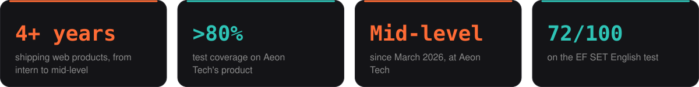
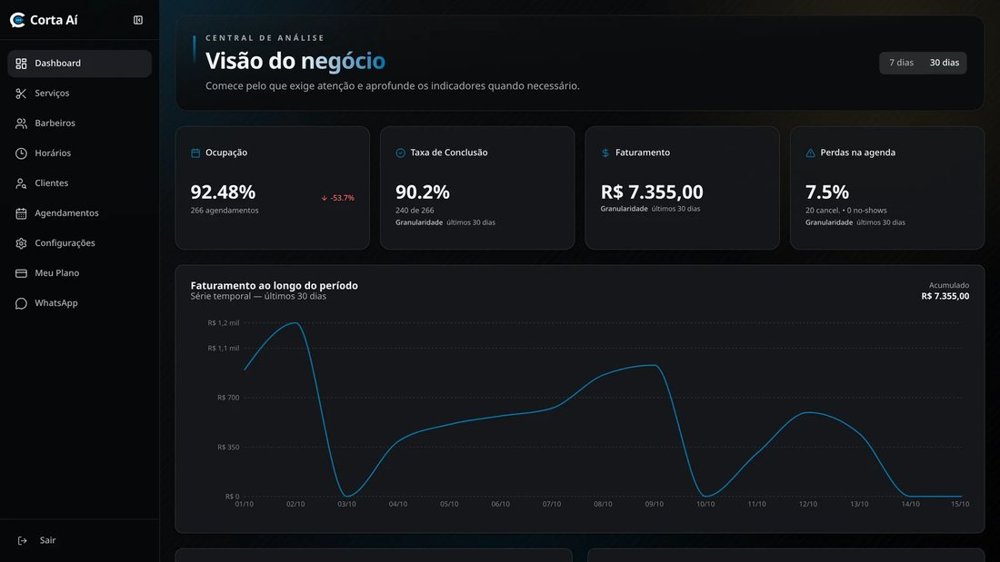
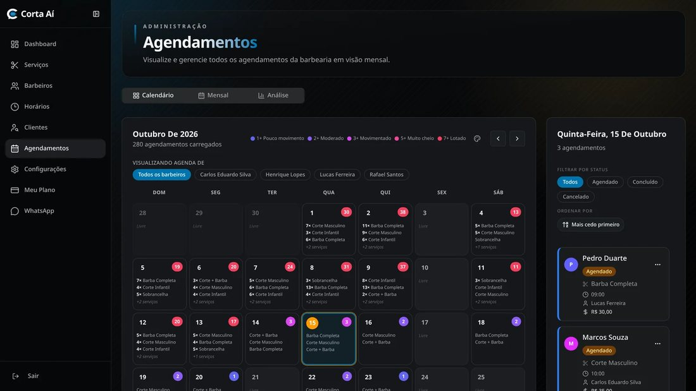
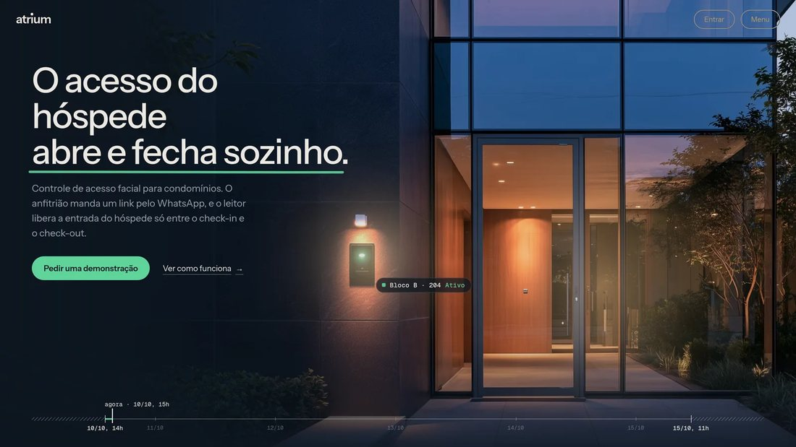
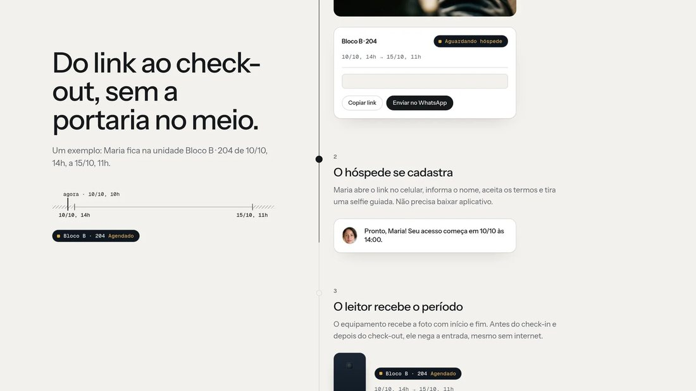
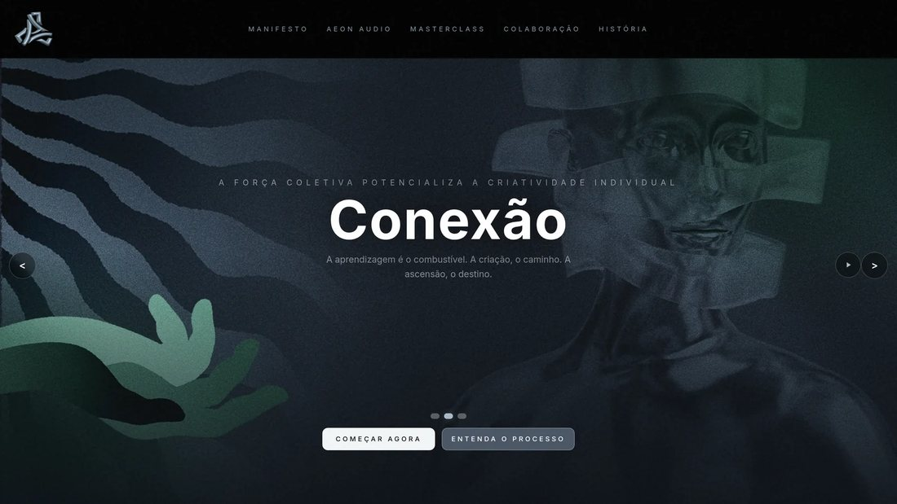
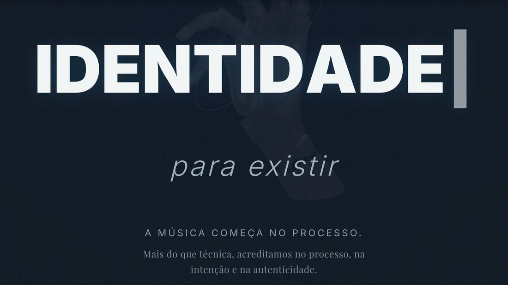

  

  
  
  

 

 
 

  
  

  
  

  
  

Live: <a href="https://corta-ai-barber.com.br/">corta-ai-barber.com.br</a> · <a href="https://aeonaudio.com.br/">aeonaudio.com.br</a> · <a href="https://atrium.kaizentechbr.com.br/">atrium.kaizentechbr.com.br</a>. The Corta-ai admin screens use fictional demo data.

Production code lives in private repositories, so these cases describe decisions and outcomes, not source. Happy to go deeper in an interview.

 

  
  
  

Off the keyboard I produce music and DJ as <b>SAERIX</b>: <a href="https://soundcloud.com/lxndr_serg">SoundCloud</a> · <a href="https://saerix.vercel.app/en/saerix">site</a>.

 

 

See the process in the open: <a href="https://github.com/Serg-Ale/matrix-rain/issues/14">spec #14</a> and its tickets in <a href="https://github.com/Serg-Ale/matrix-rain">matrix-rain</a>.

 

 

  
  
  

