

  

  
  
  

 

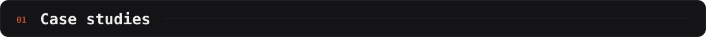

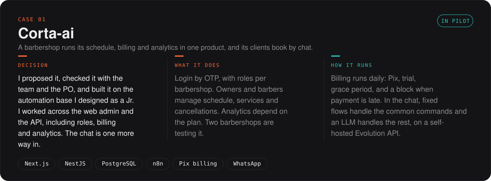

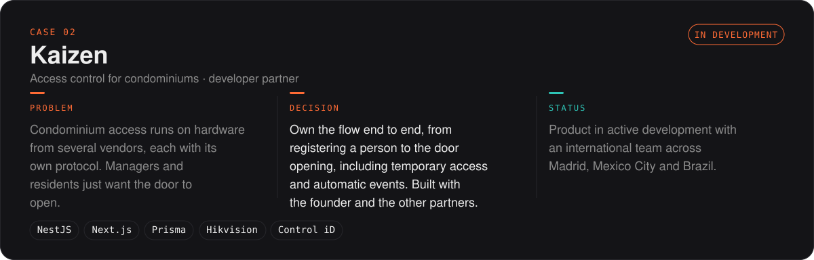

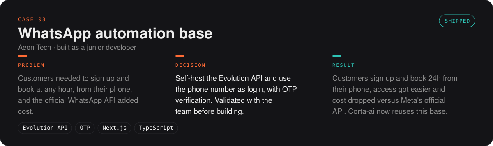

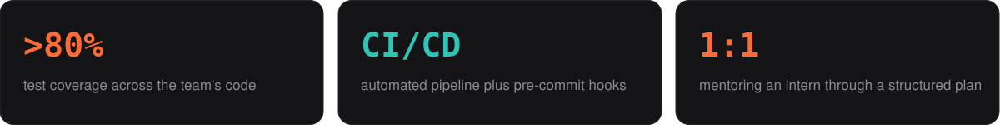

 

Production code lives in private repositories, so these cases describe decisions and outcomes, not source. Happy to go deeper in an interview.

 

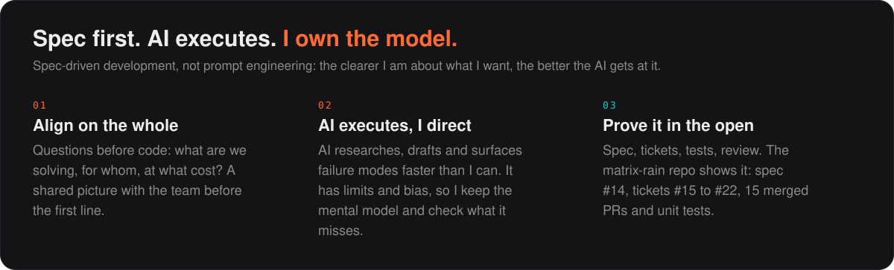

See the process in the open: <a href="https://github.com/Serg-Ale/matrix-rain/issues/14">spec #14</a> and its tickets in <a href="https://github.com/Serg-Ale/matrix-rain">matrix-rain</a>.

 

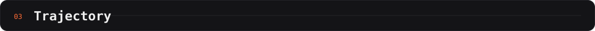

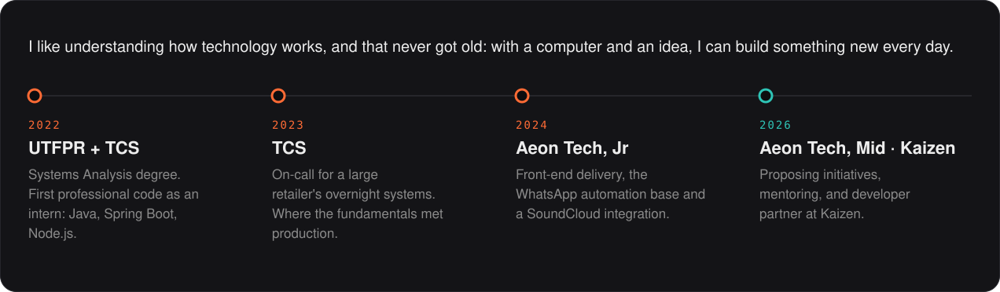

 

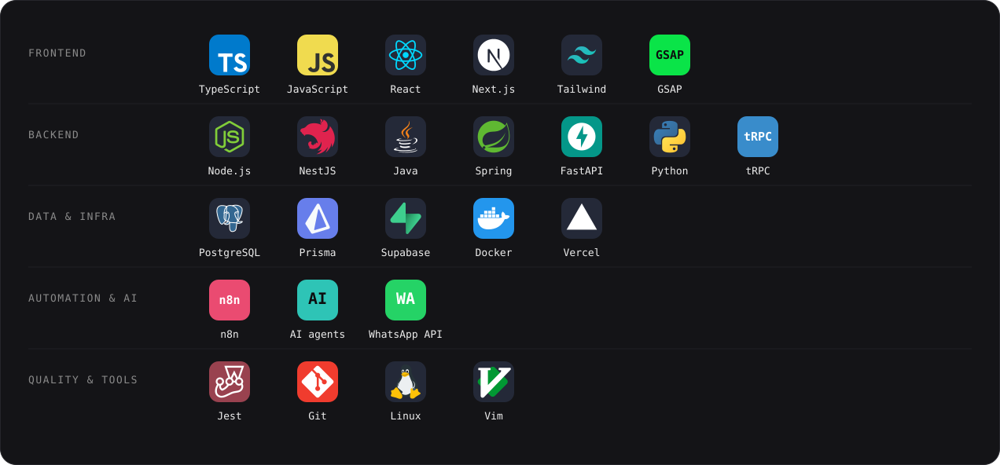

 

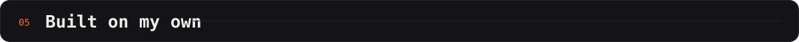

  <a href="https://gym-stuff-five.vercel.app">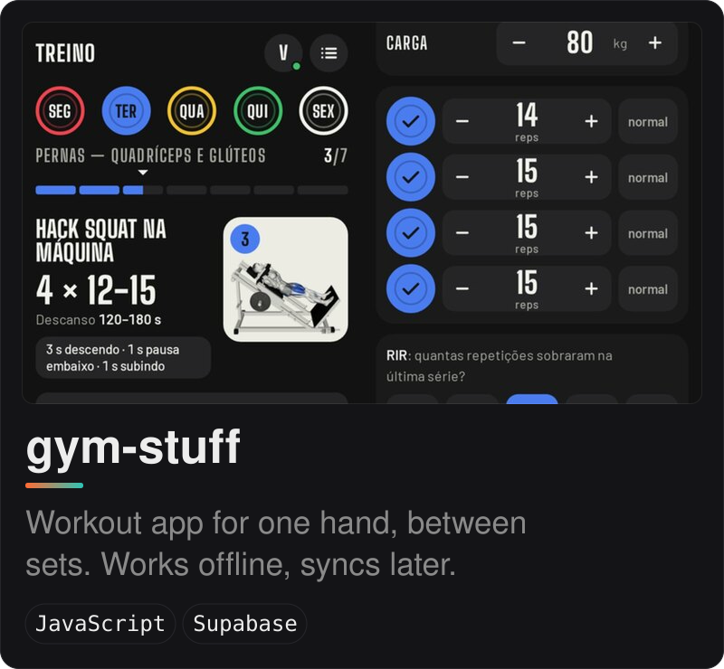</a>
  <a href="https://github.com/Serg-Ale/matrix-rain">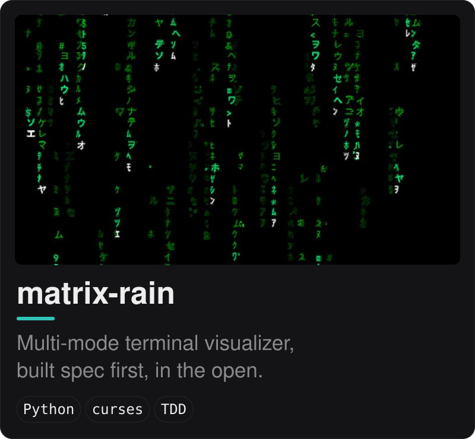</a>
  <a href="https://github.com/Serg-Ale/Como-Eles-Votaram">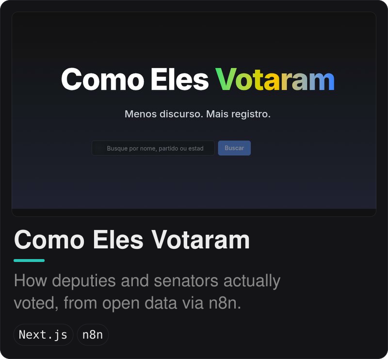</a>

Off the keyboard I produce music and DJ as <b>LXNDR</b>: <a href="https://soundcloud.com/lxndr_serg">SoundCloud</a>.

 

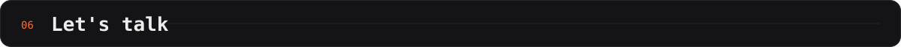

  
  
  

